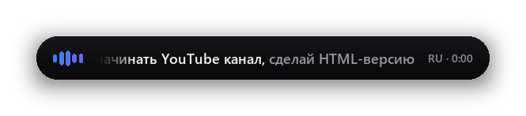
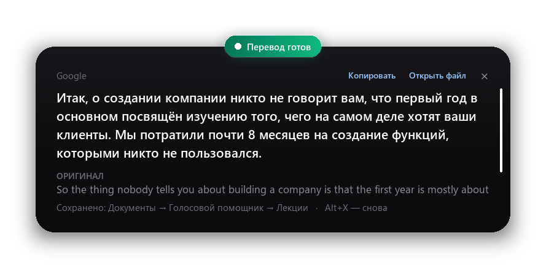
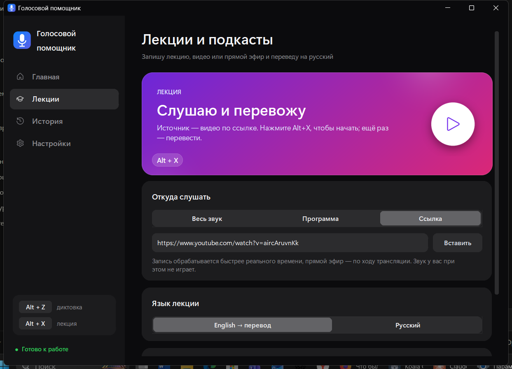
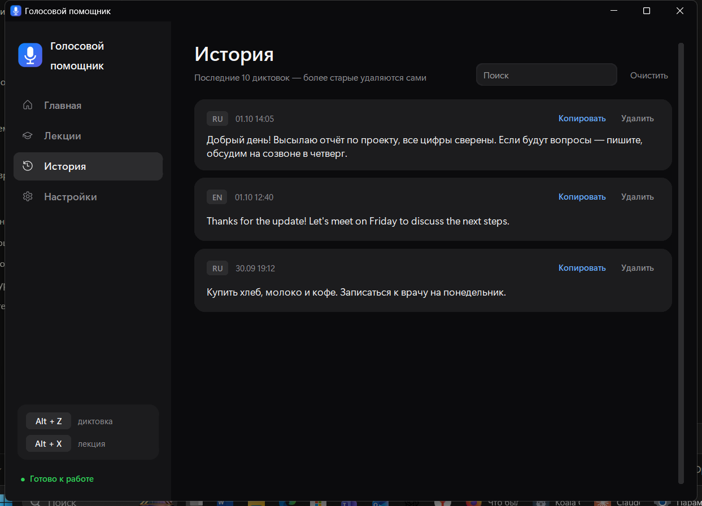
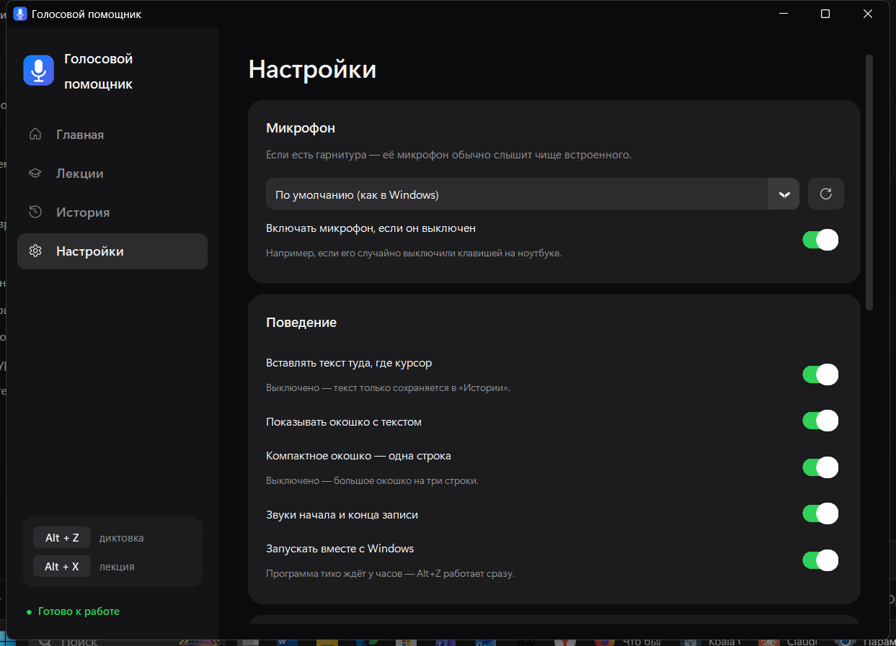

<div align="center">


# Голосовой помощник

**Диктовка, запись лекций и перевод английской речи на русский — прямо на компьютере, без подписок.**

Windows 10/11 · Python · распознавание речи офлайн · горячие клавиши `Alt+Z` / `Alt+X`

[](https://github.com/khachegemov-bot/voice-assistant/actions/workflows/tests.yml)



</div>

> **English summary.** A Windows desktop voice assistant: press `Alt+Z` and speak — words appear live in a
> floating overlay and are pasted where your cursor is. `Alt+X` transcribes an English lecture or podcast
> (whole system audio, a single app, or a YouTube/Twitch link incl. live streams) and translates it into Russian.
> Speech recognition runs **fully offline** (GigaAM v3 for Russian, NVIDIA Parakeet TDT for English, ONNX Runtime).

---

## Возможности

### 🎙 Диктовка — `Alt+Z`
- Говорите — слова **плавно проявляются** в компактной капсуле внизу экрана: строка мягко уезжает влево,
  старые слова растворяются у края; записанное — белым, уточняющееся — серым, слева пляшет индикатор голоса,
  справа — язык и таймер. В настройках можно включить большое окошко на три строки.
- Ещё раз `Alt+Z` — текст **вставляется туда, где стоит курсор** (Word, браузер, мессенджер…) уже
  перепроверенным: пока вы говорите, запись в фоне распознаётся заново целыми фразами, поэтому после «стоп»
  ждать меньше секунды при любой длине диктовки.
- Язык — **автоматически по голосу**: обе модели слушают первые ~1,5 с, побеждает более уверенная.
- Знаки препинания и заглавные буквы ставит сама модель; запинки («э-э-э», «эм», «uh») и оборванные слова
  («отве- отвечать») убираются; голосовые команды «новая строка», «новый абзац».
- **Словарь замен** — научите программу своим словам и именам: «клоуд* = Claude» (звёздочка — любое окончание).
- Если микрофон выключен в Windows (например, случайно клавишей на ноутбуке) — программа включит его сама.
- История последних 10 диктовок; автосохранение черновика — текст не теряется даже при сбое.

### 🎧 Лекции и подкасты — `Alt+X`
| Источник | Как работает |
|---|---|
| **Весь звук** | всё, что играет на компьютере |
| **Программа** | только одно приложение (Zoom, Teams, браузер) — можно параллельно смотреть своё видео в другой программе; лекцию можно приглушить «для себя», запись не страдает |
| **Ссылка** | YouTube / VK Видео / Twitch: запись обрабатывается **быстрее реального времени** (19-минутная лекция ≈ 5 минут), прямой эфир — по ходу трансляции |

Остановка — перевод **всего текста целиком** (онлайн через Google или полностью офлайн), оригинал рядом,
всё сохраняется в «Документы → Голосовой помощник → Лекции».

<div align="center">

</div>

### 🖥 Приложение
Боковое меню, карточки с градиентом, статистика (слов сегодня / всего / сколько времени сэкономлено),
поиск по истории.

<div align="center">




</div>

---

## Как это устроено

- **Распознавание речи офлайн** — [GigaAM v3](https://github.com/salute-developers/GigaAM) (русский, с пунктуацией)
  и [NVIDIA Parakeet TDT 0.6B v2](https://huggingface.co/nvidia/parakeet-tdt-0.6b-v2) (английский) в квантованном
  int8-виде через [onnx-asr](https://github.com/istupakov/onnx-asr) / ONNX Runtime. Без GPU.
- **Потоковое распознавание без потерь слов** — каждые ~0,5 с накопленный звук распознаётся заново, а засчитываются
  только слова, совпавшие в двух распознаваниях подряд (подход *LocalAgreement*). Готовые фразы отрезаются по
  времени слов, поэтому звук никогда не режется посреди слова. Короткие диктовки после «стоп» сверяются целиком.
- **Чистый звук с микрофона** — запись через WASAPI в родном формате устройства (48 кГц, оба микрофона ноутбука
  сводятся в один — шум частично гасится), качественный пересчёт в 16 кГц через soxr.
- **Нейросетевое определение речи** — [Silero VAD](https://github.com/snakers4/silero-vad) отличает голос от стука
  клавиш и шума вентилятора по звучанию, а не по громкости; усиление подбирается по уровню именно голоса.
- **Двухпроходное распознавание** — потоковое показывает слова сразу, а фоновая сверка (`Finalizer`) по ходу
  диктовки распознаёт готовые куски по 12–20 с (разрезанные в паузах) заново целиком, с укороченными паузами:
  на длинной тишине модель теряла слова. Исчезают обрывки фраз и лишние точки на стыках потоковых кусков.
  На тестовом стенде (`tools/asr_bench.py`, речь + записанный шум ноутбука) — 5 % ошибок в словах при любой
  громкости (было 6–22 %), ожидание после «стоп» — 0,3–0,7 с.
- **Микрофон** — список устройств обновляется перед каждой диктовкой (после подключения гарнитуры старые
  номера устройств неверны), при ошибке открытия — повторная попытка.
- **Скорость** — ONNX Runtime ограничен 3 потоками: у гибридных процессоров (2 быстрых + 8 экономных
  ядер) это в 2–3 раза быстрее, чем «все ядра» по умолчанию; модели прогреваются сразу после загрузки.
- **Звук одной программы** — WASAPI *process loopback* (`ActivateAudioInterfaceAsync`, `VAD\Process_Loopback`)
  через `comtypes`; захват идёт в отдельном процессе, чтобы тяжёлые вычисления не мешали забирать звук
  из 10-мс буфера Windows.
- **Ссылки и прямые эфиры** — `yt-dlp` + PyAV (FFmpeg), автопереподключение при обрыве эфира.
- **Перевод** — Google (онлайн, абзацами с контекстом) или [OPUS-MT](https://github.com/Helsinki-NLP/Opus-MT)
  через CTranslate2 (офлайн).
- **Интерфейс** — главное окно на CustomTkinter, карточки с градиентом и анимацией рисуются Pillow;
  всплывающие окна (30 кадров/с, ~3 мс на кадр) показываются через *layered windows* Windows
  (`UpdateLayeredWindow`) — с попиксельной прозрачностью, без перехвата фокуса. Слова сопоставляются
  с прошлым кадром (`difflib`), поэтому исправленное слово проявляется на месте, а не печатается заново.
- Системные горячие клавиши `RegisterHotKey` (работают при любой раскладке), иконка в трее, автозапуск,
  сборка в один `.exe`-каталог через PyInstaller.

| Файл | Что внутри |
|---|---|
| `app.py` | приложение: диктовка, лекции, перевод, главное окно, горячие клавиши, трей |
| `recognition.py` | модели, определение языка по голосу, потоковое распознавание, фоновая сверка |
| `textproc.py` | обработка текста: склейка кусков, голосовые команды, слова из токенов (без зависимостей) |
| `dsp.py` | обработка звука на numpy: фильтр, разметка речи, сжатие пауз, разрезание в паузах |
| `paths.py` | где лежат модели и данные (из исходников и в собранном `.exe`) |
| `overlay_ui.py` | всплывающие окна на layered windows |
| `process_audio.py` | захват звука одной программы (WASAPI process loopback) |
| `audio_input.py` | захват микрофона (WASAPI + soxr) и определение речи (Silero VAD) |
| `ui_main.py` | элементы главного окна: карточки с градиентом, кнопка с «дышащим» кольцом, индикатор голоса |
| `launcher.pyw` | перезапуск после сбоя |
| `tools/` | загрузка моделей, стенд качества распознавания, диагностика микрофона, снимки экрана, инструкция |
| `tests/` | автотесты (pytest) — запускаются на GitHub Actions при каждом изменении |

### Тесты

Потоковое распознавание проверяется с поддельной моделью, которая «слышит» слово, только если его звук целиком
попал в буфер: при любой нарезке звука каждое слово должно попасть в текст ровно один раз и никогда не
обрезаться в начале. Плюс склейка кусков (лишняя точка → запятая, голосовые команды), сжатие пауз и разрезание
длинной записи. Тесты не требуют Windows и моделей.

```bash
venv\Scripts\python -m pytest       # 41 тест, < 1 с
venv\Scripts\ruff check .
```

Качество на живом звуке — отдельный стенд `tools/asr_bench.py`: синтезированная речь + записанный шум ноутбука
на трёх уровнях громкости, ошибка в словах (WER).

---

## Запуск из исходников

```bash
python -m venv venv
venv\Scripts\pip install -r requirements.txt
venv\Scripts\python tools\download_models.py      # ≈1,1 ГБ моделей в папку models/
venv\Scripts\pythonw app.py
```

Сборка `.exe`:

```bash
venv\Scripts\pyinstaller voice_assistant.spec      # результат — dist\Голосовой помощник\
```

Подробная инструкция для пользователей — [`Инструкция.html`](Инструкция.html).

---

## Лицензии моделей

GigaAM v3 — MIT · NVIDIA Parakeet TDT 0.6B v2 — CC-BY-4.0 · OPUS-MT — CC-BY-4.0 · Silero VAD — MIT.
Код проекта — [MIT](LICENSE).
